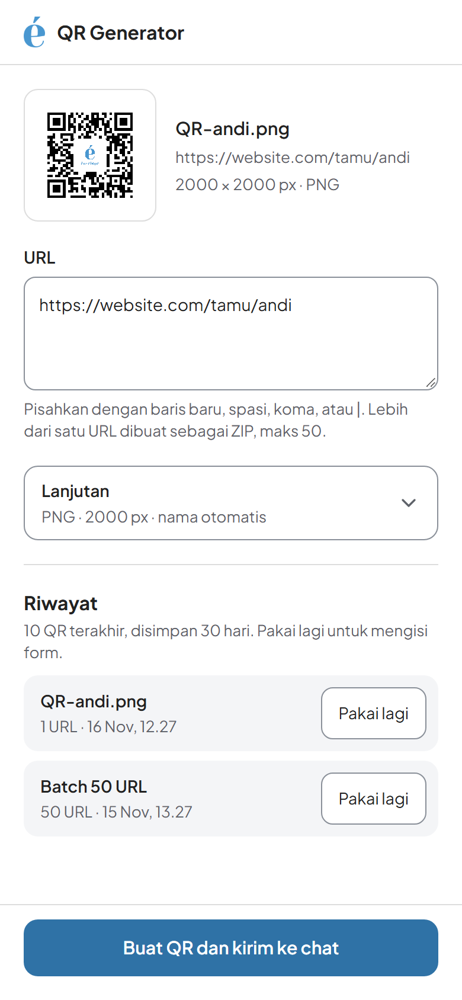
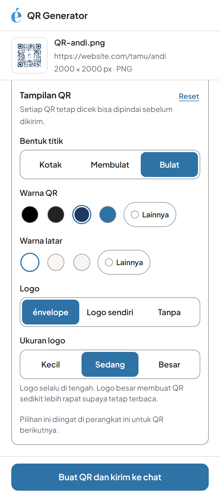
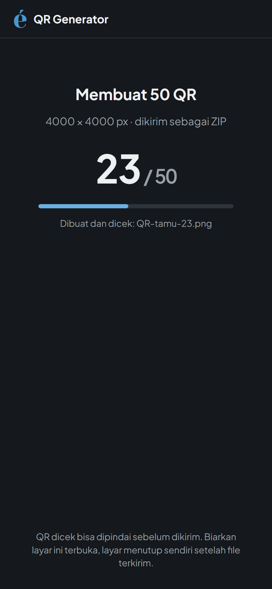
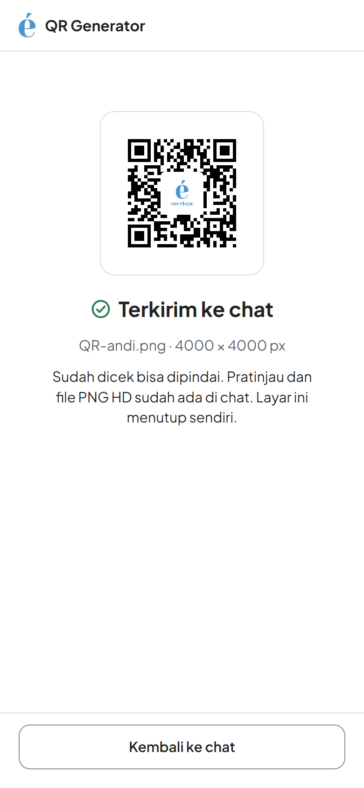
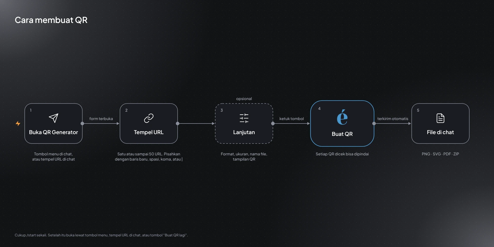
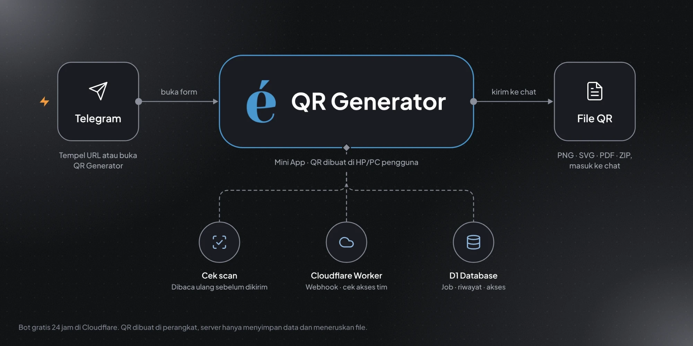

  <picture>
    <source media="(prefers-color-scheme: dark)" srcset="docs/header-dark.png">
    
  </picture>

  Bot Telegram untuk membuat QR berlogo énvelope, misalnya untuk link undangan tiap tamu. 
  QR dibuat lewat Telegram Mini App, dicek bisa dipindai, lalu dikirim sebagai file ke chat.

  
  
  

---

## Tampilan

<table>
  <tr>
    <td align="center" valign="top" width="25%"></td>
    <td align="center" valign="top" width="25%"></td>
    <td align="center" valign="top" width="25%"></td>
    <td align="center" valign="top" width="25%"></td>
  </tr>
  <tr>
    <td align="center"><b>Form</b> Tempel URL, pratinjau langsung muncul</td>
    <td align="center"><b>Lanjutan</b> Format, ukuran, nama file, tampilan QR</td>
    <td align="center"><b>Batch</b> Sampai 50 QR sekaligus dalam ZIP</td>
    <td align="center"><b>Berhasil</b> File QR langsung masuk ke chat</td>
  </tr>
</table>

Mini App mengikuti tema terang atau gelap Telegram pengguna.

## Cara membuat QR

  

1. **Buka QR Generator** lewat tombol menu di chat bot, atau tempel URL langsung di chat.
2. **Tempel URL**: satu, atau sampai 50 sekaligus.
3. **Lanjutan** *(opsional)*: pilih format, ukuran, nama file, dan tampilan QR. Pilihan diingat untuk berikutnya.
4. **Buat QR**: setiap QR dicek bisa dipindai sebelum dikirim.
5. **File masuk ke chat**: PNG, SVG, PDF, atau ZIP untuk batch.

## Fitur

| Fitur | Keterangan |
|---|---|
| **Satu atau banyak QR** | Satu QR, atau sampai 50 sekaligus dalam satu ZIP. URL boleh dipisah baris baru, spasi, koma, `\|`, atau `;`. URL ganda dilewati otomatis. |
| **Format** | PNG 1000 sampai 4000 px untuk layar, SVG atau PDF vektor untuk percetakan (tajam di ukuran berapa pun). |
| **Tampilan QR** | Bentuk titik, warna QR dan latar (dengan peringatan kontras), logo énvelope, logo sendiri, atau tanpa logo, beserta ukurannya. |
| **Cek scan otomatis** | Setiap QR dibaca ulang sebelum dikirim. QR yang tidak terbaca tidak dikirim. |
| **Riwayat** | 10 QR terakhir tersimpan 30 hari dan bisa dibuat lagi dengan pengaturan lain. |
| **Akses khusus tim** | Orang di luar tim ditolak. Admin memberi atau mencabut akses langsung dari chat bot. |

### Contoh hasil

<table>
  <tr>
    <td align="center"></td>
    <td align="center"></td>
    <td align="center"></td>
  </tr>
  <tr>
    <td align="center">Kotak (bawaan)</td>
    <td align="center">Membulat, latar krem</td>
    <td align="center">Titik bulat, biru tua</td>
  </tr>
</table>

## Cara kerja

  

**Kenapa QR dibuat di perangkat pengguna?** Paket gratis Cloudflare hanya memberi sekitar 10 ms CPU
per permintaan, tidak cukup untuk membuat PNG 4000 px atau 50 QR sekaligus. Dengan membuat QR di
Mini App, server cukup menyimpan data dan meneruskan file, jadi bot tetap gratis dan berjalan 24 jam.

## Isi repo

| Folder / file | Isi |
|---|---|
| [`cloudflare/`](cloudflare/) | Bot versi sekarang: Worker, Mini App, skema database, skrip setup. Panduan lengkap ada di [`cloudflare/README.md`](cloudflare/README.md). |
| [`docs/`](docs/) | Screenshot, contoh QR, dan diagram (cara membuat QR, cara kerja) untuk README ini |
| [`telegram-profile/`](telegram-profile/) | Foto profil dan gambar deskripsi bot untuk diunggah lewat @BotFather |
| `bot.py`, `logo.png` | Versi awal bot dalam Python. Tidak dipakai lagi sejak pindah ke Cloudflare, disimpan sebagai arsip. |

## Mulai cepat

Butuh Node.js, akun Cloudflare, dan token bot dari @BotFather.

1. Buat file `.env` di root repo berisi `BOT_TOKEN=token-dari-botfather`.
2. Di folder `cloudflare`, jalankan `npm install`.
3. Ikuti langkah deploy di [`cloudflare/README.md`](cloudflare/README.md): login Cloudflare, buat database D1,
   `npm run deploy`, lalu `npm run setup`.

Mencoba tampilan Mini App tanpa Telegram: jalankan `npm run dev` di folder `cloudflare`, lalu buka
`http://127.0.0.1:8787/?preview=form`. Bar di atas halaman berisi tombol untuk berpindah ke semua layar
dan tema.

## Keamanan

- `.env` (token bot) dan `cloudflare/.dev.vars` tidak pernah di-commit (lihat [`.gitignore`](.gitignore)).
- Di Cloudflare, token bot, secret webhook, dan daftar admin disimpan sebagai *secret* Worker, bukan di kode.
- Webhook diverifikasi dengan secret token, dan setiap permintaan dari Mini App diverifikasi dengan
  tanda tangan Telegram (`initData`) sebelum file dikirim.
